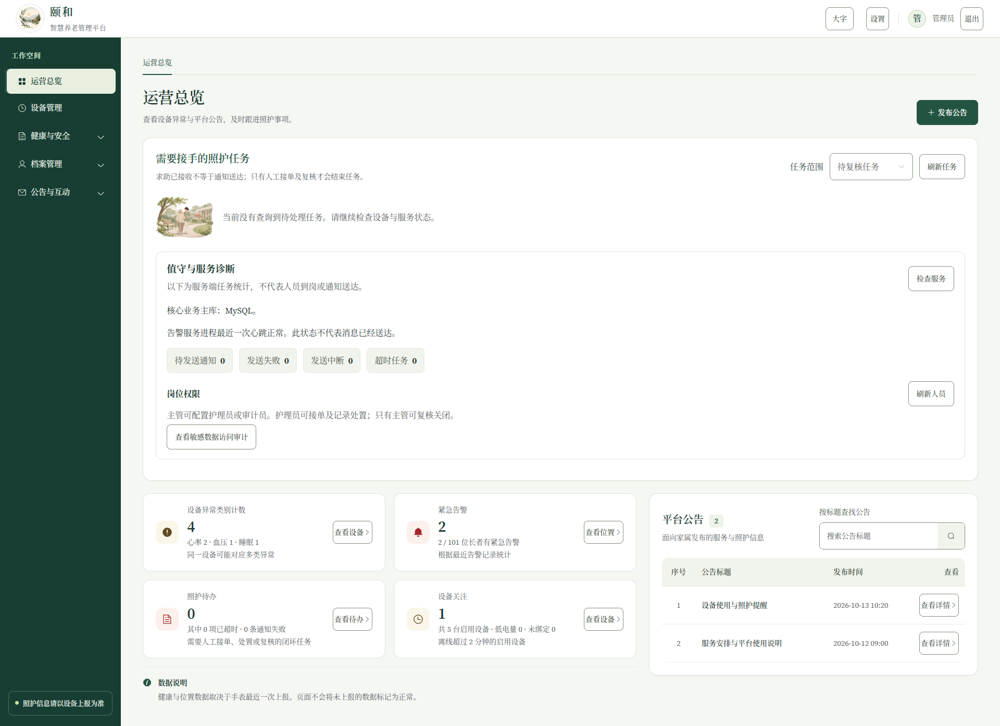
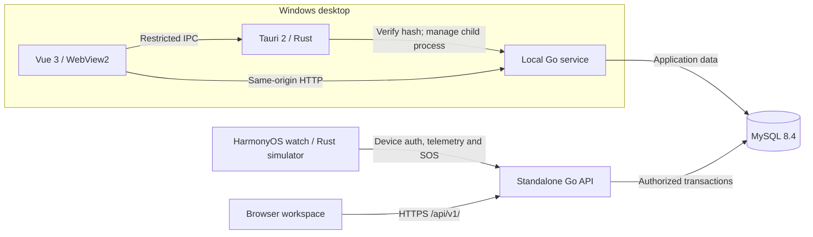

<p align="center">
  
</p>

<h1 align="center">Yihe · Elderly Care Management</h1>

<p align="center">A care workspace for resident records, wearable monitoring, and response coordination.</p>

<p align="center">
  <a href="README.md">简体中文</a> · <a href="README.en.md">English</a>
</p>

[](https://github.com/qiyuhuating/yihe-health/actions/workflows/ci.yml?query=branch%3Amain)
[](https://github.com/qiyuhuating/yihe-health/actions/workflows/security.yml?query=branch%3Amain)
[](LICENSE)
[](https://github.com/qiyuhuating/yihe-health/issues)
[](https://github.com/qiyuhuating/yihe-health/pulls)
[](https://github.com/qiyuhuating/yihe-health/issues/new?template=accessibility_barrier.yml)

Community: [Report a bug or request a feature](https://github.com/qiyuhuating/yihe-health/issues/new/choose) · [Contribute](docs/CONTRIBUTING.md) · [Accessibility feedback](docs/ACCESSIBILITY.md) · [Private security reporting](.github/SECURITY.md) · [Code of conduct](docs/CODE_OF_CONDUCT.md)

[Capabilities](#capabilities) · [First-time setup](#first-time-setup) · [Architecture](#architecture) · [Development](#development) · [Troubleshooting](#troubleshooting) · [Documentation and support](#documentation-and-support)

> **Project status**: This repository is under active development and has no pre-built binary releases yet. Build the desktop client/server from source or start the local Docker Compose stack; **MySQL 8.4** is the sole application datastore.

Yihe combines resident records, wearable readings, location alerts, and care tasks for care organizations and authorized family members. This repository includes the Windows desktop client, a separately deployable Go server, browser interface, HarmonyOS watch app, and Rust protocol simulator.



*The screenshot uses test data. Available capabilities depend on the deployed environment, devices, and connected services.*

## Capabilities

| Use case | What users can do |
| --- | --- |
| Residents and families | Maintain resident, guardian, and family associations; invite family members to view authorized records |
| Wearables and health | Register and bind watches; review heart rate, blood pressure, sleep, steps, and timestamps; distinguish missing from reported readings |
| Locations and alerts | Review device-reported positions, SOS events, and alerts without confusing historical locations with live tracking |
| Care coordination | Claim and document alert-response tasks, escalate outstanding cases, and have an authorized second supervisor review interventions |
| Notices | Publish announcements and moderate comments with administrator and family visibility controls |
| Desktop accessibility | Adjust text size and contrast, use keyboard navigation and fullscreen, configure map preferences, and retry failed health-record requests without mistaking failures for empty data; administrators manage two-factor authentication in the header settings |
| Network risk controls | Retain per-IP and account failure budgets; add independent IPv6 network budgets for login and invitation failures without treating a single failure on a shared network as abuse |

**Typical workflow:** create a resident record → link family members → bind a watch → receive data → handle an alert task → obtain independent review. Families see only their linked residents; server-side permissions govern staff operations.

**Operational limits:** missing readings are not evidence of normal health. A notification gateway accepting a request does not prove message delivery or that staff responded. Unattended SOS handling needs an independent, always-on service, reliable notification channels, and staffed procedures.

Daily statistics refresh on demand: querying a stale day returns a pending status until background recomputation finishes. Unrequested historical days are not continuously recomputed.

Automatic watch sync combines pending and fresh samples into one upload when queue capacity permits, preserving record IDs and durable acknowledgements.

Consecutive successful monitoring cycles reuse a recent binding hint and submit signed uploads for authoritative server validation. Empty cycles, failures and expired hints require login.

## First-time setup

### Windows desktop (built from source)

1. Provision **MySQL 8.4** and a dedicated application account. Production environments also need database backups, access controls, and TLS where appropriate. The connection uses a Go MySQL DSN such as `yihe:password@tcp(127.0.0.1:3306)/yihe?parseTime=true`; use your actual host and port.
2. For a new installation, generate a random 32-byte encryption key and **store it securely**. The following PowerShell 7 command produces its Base64 representation. Reuse the existing key for upgrades; regenerating it can make previously encrypted data unreadable.

   ```powershell
   [Convert]::ToBase64String([Security.Cryptography.RandomNumberGenerator]::GetBytes(32))
   ```

3. After [building from source](#development), provide the database DSN and saved key in the desktop launch environment (the Windows client requires WebView2). This interactive example avoids hardcoding real credentials into the repository.

   ```powershell
   $env:YIHE_MYSQL_DSN = Read-Host 'MySQL DSN' -MaskInput
   $env:DATA_ENCRYPTION_KEY = Read-Host 'Saved Base64 encryption key' -MaskInput
   $env:SESSION_BACKEND = 'database'
   .\yihe.exe
   ```

4. Once migrations complete, follow the initial setup screen to create an administrator, then add residents and bind watches. **There is no default admin account or shared password.**

The interface may open when MySQL is unreachable, but login and data writes require a ready database. Backups must include stored image/health data, BLOB columns, and recoverable encryption keys. Migrating from an earlier PostgreSQL/S3 deployment requires stopping writers, backing up, and following the [MySQL-only migration guide](docs/MYSQL_ONLY_MIGRATION.md); the application does not migrate data automatically.

Set `MYSQL_STATISTICS_MAX_CONNS` (0–64, default 0) to enable a dedicated health statistics pool on the same MySQL primary. Budget 20 business connections, one liveness connection, the configured statistics connections, and `MYSQL_SOS_MAX_CONNS` (0–8, default 0) reserved SOS connections per instance. Each service instance admits at most eight concurrent health uploads and eight waiting requests outside the connection pool for up to 200 ms. Overload returns HTTP 503 with Retry-After; clients must retain unacknowledged records. Compose accepts `MYSQL_REDO_LOG_CAPACITY` (default 1 GiB); evaluate 4 GiB against storage and recovery requirements for sustained writes, without relaxing synchronous durability.

Health uploads are admitted serially per device, with eight active slots and eight waiting slots per service instance. Optional YIHE_SOS_PRIORITY=1 pauses new uploads from the authenticated SOS device and temporarily reduces the global upload budget to six. Waiting does not hold a SQL connection. It defaults to off; enable only after validating local workload latency.

### Always-on deployments and local Compose

The desktop starts a local Go child process and stops it when the window closes. To receive remote watch uploads and SOS continuously, deploy a separate server following the [care service deployment guide](docs/CARE_SERVICE_DEPLOYMENT.md), with HTTPS, access restrictions, monitoring, and staffed escalation procedures.

For a local complete stack, install Docker Compose and Python 3, then run from the repository root:

```bash
python3 scripts/start-platform.py
python3 scripts/bootstrap-admin.py
```

The stack starts MySQL 8.4, the Go API, Nginx, and monitoring. By default, the workspace is `http://127.0.0.1:8080` and Prometheus is `http://127.0.0.1:9090`, both bound to loopback. Back up `deploy/secrets/`, `deploy/platform.env`, and the MySQL volume. Do not expose this local configuration directly to the public internet.

## Architecture



MySQL 8.4 is the **only production application database** for resident data, sessions, alerts, health records, audit events, and images. The desktop verifies the Go binary SHA-256 before launching it; the bootstrap token passes through the process environment, not the web page. The local desktop server binds to loopback and is not a public endpoint for watches.

`/healthz` indicates process liveness, while `/api/v1/service/status` reports database readiness. See the [architecture guide](docs/ARCHITECTURE.md) for the trust boundaries, permissions, and migration design.

## Development

The active default branch is `main`. Use Bash on Linux VPS hosts and Windows WSL (including Codex). General development requires Node.js 26.x and Go 1.27.4; Rust modules require Rust 1.100.0 or newer. On WSL, keep the checkout in the Linux filesystem (for example, `~/projects`) rather than installing large dependency trees under `/mnt/c`.

```bash
mkdir -p ~/projects
cd ~/projects
git clone https://github.com/qiyuhuating/yihe-health.git
cd yihe-health
```

Native Windows Tauri/NSIS packaging still requires PowerShell 7, MSVC C++ Build Tools and the Windows SDK on Windows. See [build setup](docs/BUILD.md). Run from the root of a native Windows checkout:

```powershell
./desktop/validate-version.ps1
./desktop/build.ps1
```

Main directories: `frontend/` (Vue UI), `backend/` (Go API and MySQL migrations), `desktop/` (Tauri client and packaging), `YiheWatch/` (HarmonyOS wearable), `watch-sim/` (Rust simulator), `yihe-core/` (Rust statistics accelerator), and `deploy/` (containers and monitoring).

Useful change-scoped checks:

```bash
(cd backend && go test -count=1 ./... && go vet ./...)
(cd frontend && npm ci && npm run typecheck && npm test && npm run build)
```

Database integration and race tests need a **disposable test database** configured through `TEST_MYSQL_DSN`; some tests skip without it. Native HarmonyOS builds, real watches, SMS gateways, production migrations, and long-running availability require independent verification. See the [testing guide](docs/TESTING.md).

## Troubleshooting

| Symptom | What to check |
| --- | --- |
| Window opens, but login or saving fails | MySQL connectivity, DSN, migration state, and `DATA_ENCRYPTION_KEY`; `/healthz` alone does not prove database readiness |
| Portable application will not launch | Keep `yihe.exe` and `yihe-server.exe` together, and verify WebView2 is installed |
| A watch cannot connect | The desktop server only listens on loopback; connect external devices to a separately deployed Go API |
| Legacy deployment settings fail | PostgreSQL analytics and S3 are no longer runtime dependencies; follow the migration guide without discarding old data |
| Need to recover data | Back up MySQL, encryption keys, and deployment configuration; test recovery in an isolated environment |

The backend supports bounded offline encryption backfills through `go run ./cmd/yihe-ctl protect <target> --limit 100`. For care notes, use `go run ./cmd/protect-notes --limit 100`. Both default to a read-only preview; stop all writers and verify your backup before adding `--apply`. See the [backend operations guide](backend/README.md).

## Documentation and support

The [documentation index](docs/INDEX.md) groups setup, development, operations and security guides by task.

| Task | References |
| --- | --- |
| Deployment, migration, backup | [MySQL migration](docs/MYSQL_ONLY_MIGRATION.md) · [Backup/restore](docs/runbooks/backup-restore.md) |
| Architecture and APIs | [Implementation guide](docs/ARCHITECTURE.md) · [API contracts](docs/API_CONTRACTS.md) |
| Watches and simulation | [Watch integration](docs/WATCH_INTEGRATION.md) · [Rust simulator](watch-sim/README.md) |
| Help and contributions | [Support](docs/SUPPORT.md) · [Contributing](docs/CONTRIBUTING.md) · [Issue templates](https://github.com/qiyuhuating/yihe-health/issues/new/choose) |

When reporting a bug, include the **branch or commit SHA, reproduction steps, OS, deployment mode, and redacted logs**. Never publish resident health records, locations, passwords, or device keys. Use [private security reporting](.github/SECURITY.md) for vulnerabilities.

Code is licensed under [MIT](LICENSE); bundled fonts, maps, and third-party dependencies retain their own licensing terms.
