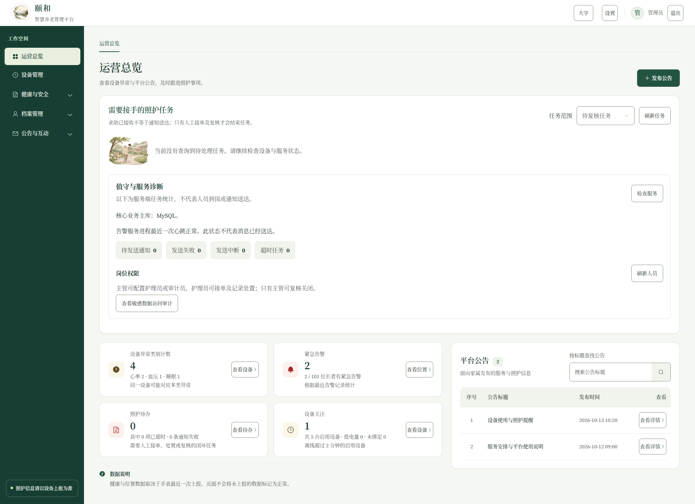
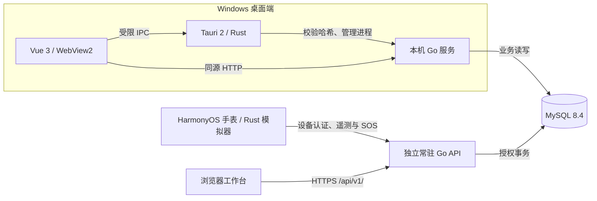

<p align="center">
  
</p>

<h1 align="center">颐和 · 智慧养老管理</h1>

<p align="center">岁月有伴，日常安宁。<br>面向养老照护场景的设备管理、健康监测和协作工作台。</p>

<p align="center">
  <a href="README.md">简体中文</a> · <a href="README.en.md">English</a>
</p>

[](https://github.com/qiyuhuating/yihe-health/actions/workflows/ci.yml?query=branch%3Amain)
[](https://github.com/qiyuhuating/yihe-health/actions/workflows/security.yml?query=branch%3Amain)
[](LICENSE)
[](https://github.com/qiyuhuating/yihe-health/issues)
[](https://github.com/qiyuhuating/yihe-health/pulls)
[](https://github.com/qiyuhuating/yihe-health/issues/new?template=accessibility_barrier.yml)

社区入口：[反馈缺陷或建议](https://github.com/qiyuhuating/yihe-health/issues/new/choose) · [参与贡献](docs/CONTRIBUTING.md) · [无障碍反馈](docs/ACCESSIBILITY.md) · [私密安全报告](.github/SECURITY.md) · [行为准则](docs/CODE_OF_CONDUCT.md)

[功能与使用场景](#功能与使用场景) · [首次启动](#首次启动) · [系统架构](#系统架构) · [开发与构建](#开发与构建) · [常见问题](#常见问题) · [文档与反馈](#文档与反馈)

> **项目状态**：当前仓库处于持续开发阶段，暂未发布预编译发行包。请通过源码构建桌面端/服务端，或使用本地 Compose 启动完整服务栈；业务数据统一使用 **MySQL 8.4** 单库存储。

颐和将长者档案、手表数据、位置告警和照护任务集中在同一工作台，供照护机构及已关联的家属使用。仓库同时包含 Windows 桌面端、可独立部署的 Go 服务、浏览器界面、HarmonyOS 手表端及 Rust 协议模拟器。



*界面示例使用测试数据；具体功能取决于所部署环境、设备和服务配置。*

## 功能与使用场景

| 使用场景 | 可以完成的工作 |
| --- | --- |
| 长者与家属档案 | 维护基础资料、监护和家属关联，通过邀请码为家属开通受限访问 |
| 设备与健康数据 | 登记和绑定手表，查看心率、血压、睡眠、步数及采样时间；区分缺失、历史和实时上报 |
| 位置与异常处理 | 查看设备报告的位置、SOS 和告警，识别最后上报时间，避免将历史位置误认为实时定位 |
| 照护协作 | 对告警工单接单、记录处置与升级，并由具备权限的其他主管复核 |
| 机构公告 | 发布通知、管理评论，按管理端和家属端权限展示 |
| 桌面使用体验 | 支持字号调节、高对比度、键盘操作、全屏和窄屏布局；可调整地图偏好；健康记录区分加载失败与无数据，并支持重试；管理员可在顶部设置中管理双因素认证 |
| 网络风控 | 保留 IP 与账号失败预算，增加独立的 IPv6 网段登录和邀请码失败预算；正常共享网络不因单次失败封禁 |

**典型流程：** 建立长者档案 → 关联家属 → 登记并绑定手表 → 接收上报 → 处理告警工单 → 独立复核。家属仅能查看获授权的长者信息，岗位权限由服务端执行。

**使用边界：** 未上报不代表健康状态正常；网关接受通知也不代表家属已收到或照护人员已到场。真实 SOS 值守必须配置独立常驻服务、可靠通知渠道和人工响应机制，不能只依赖桌面窗口。

日统计按需刷新：采样变更后，查询过期日期会先返回待计算状态，后台随后更新结果；未查询的历史日期不再持续重算。

手表自动同步在队列容量允许时将积压与新采样合并为一次上传，保留原记录 ID 和持久化确认机制。

连续成功的手表自动监测周期直接签名上传，由服务端在事务内校验绑定；无采样、失败恢复或提示过期时仍执行登录。

## 首次启动

### Windows 桌面端（源码构建后运行）

1. 准备 **MySQL 8.4** 数据库及专用账号，授予应用所需权限。生产部署还需设置备份、TLS 和访问限制。数据库连接信息采用 Go MySQL DSN 格式，例如 `yihe:密码@tcp(127.0.0.1:3306)/yihe?parseTime=true`；实际端口按部署环境调整。
2. 首次部署时生成并**安全保存**随机 32 字节数据加密密钥。可以在 PowerShell 7 中生成 Base64 值，保存到受控密钥存储；升级时必须使用原有密钥，不能每次重新生成。

   ```powershell
   [Convert]::ToBase64String([Security.Cryptography.RandomNumberGenerator]::GetBytes(32))
   ```

3. 完成[源码构建](#开发与构建)后，将数据库连接和保存的密钥配置到桌面启动环境，再运行生成的客户端程序（Windows 桌面端依赖系统 WebView2 运行环境）。以下命令会交互式读取配置，不需要将真实密码写入仓库。

   ```powershell
   $env:YIHE_MYSQL_DSN = Read-Host 'MySQL DSN' -MaskInput
   $env:DATA_ENCRYPTION_KEY = Read-Host 'Saved Base64 encryption key' -MaskInput
   $env:SESSION_BACKEND = 'database'
   .\yihe.exe
   ```

4. 确认数据库迁移完成后，按初始化界面创建管理员，再建立长者档案与设备绑定。**没有预置管理员账号或通用密码。**

数据库连接失败时仍可能打开界面，但登录和业务写入不可用。图片及健康相关数据存储在 MySQL 中，备份必须包含 BLOB 和用于解密的密钥。旧 PostgreSQL/S3 部署的迁移必须停写、备份并按 [MySQL 单库迁移手册](docs/MYSQL_ONLY_MIGRATION.md) 操作，系统不会自动迁移旧数据。

可选设置 `MYSQL_STATISTICS_MAX_CONNS`（0–64，默认 0）为健康统计启用同一 MySQL 主库的独立连接池，避免统计事务耗尽原有业务连接。部署时须按每个实例的 `MYSQL_MAX_OPEN_CONNS`（1–64，默认 20）个业务连接、1 个探活连接、配置的统计连接以及 `MYSQL_SOS_MAX_CONNS`（0–8，默认 0）独立求助连接预算核算 MySQL 总连接数。健康批量上报在每个服务实例最多允许 8 个并发写事务、8 个连接池外等候请求（最多 200 ms），超限返回 HTTP 503 和 Retry-After，客户端须保留待上传记录。Compose 可用 `MYSQL_REDO_LOG_CAPACITY` 指定 redo 容量（默认 1 GiB）；高写入负载可按磁盘与恢复目标评估 4 GiB，保留同步刷盘。

健康上报按设备串行准入，仍保留每实例 8 个活动槽和 8 个等候槽。可选的 YIHE_SOS_PRIORITY=1 在 SOS 通过凭据校验后暂停同设备的新上传，并临时将全局健康写入预算降至 6；等待期间不占用 SQL 连接。该选项默认关闭，仅适合经本地负载验证后启用。

### 常驻服务与本地 Compose

桌面端使用本机 Go 子进程，关闭窗口会终止本地服务。需要持续接收远程手表数据和 SOS，请按 [照护服务部署说明](docs/CARE_SERVICE_DEPLOYMENT.md) 部署独立常驻服务，并为对外接口配置 HTTPS、访问控制和实际值班流程。

如需在本地启动完整服务栈，安装 Docker Compose 与 Python 3，在仓库根目录运行：

```bash
python3 scripts/start-platform.py
python3 scripts/bootstrap-admin.py
```

脚本启动 MySQL 8.4、Go API、Nginx 和监控，默认工作台地址为 `http://127.0.0.1:8080`，Prometheus 为 `http://127.0.0.1:9090`，均仅绑定本地回环地址。`deploy/secrets/`、`deploy/platform.env` 与 MySQL 数据卷需要妥善备份。不要将本地默认配置直接暴露到公网。

## 系统架构

健康记录以 MySQL 中已提交的数据为准。启用健康统计内存缓存后，每次读取都先检查访问权限和 MySQL 中该老人的数据版本。版本变化时重新计算，没有版本记录时直接查询 MySQL。服务重启后，统计结果可从数据库重新生成。



MySQL 8.4 是**唯一生产业务数据库**，保存档案、会话、告警、健康数据、审计和图片。桌面程序在启动前校验 Go 程序 SHA-256；控制令牌只通过进程环境变量传递，不暴露给网页。桌面本地服务仅监听回环地址，不能直接供外部手表访问。

服务的 `/healthz` 仅检查进程存活；`/api/v1/service/status` 才用于判断数据库就绪。具体信任边界、岗位授权和迁移设计见 [架构文档](docs/ARCHITECTURE.md)。

## 开发与构建

当前主分支为 `main`。Linux VPS 和 Windows WSL（包括 Codex）默认使用 Bash；通用开发要求 Node.js 26.x、Go 1.27.4，Rust 模块使用 Rust 1.100.0 或更高版本。WSL 建议将源码放在 Linux 文件系统（如 `~/projects`），避免在 `/mnt/c` 下安装大量依赖。

```bash
mkdir -p ~/projects
cd ~/projects
git clone https://github.com/qiyuhuating/yihe-health.git
cd yihe-health
```

Windows 原生 Tauri/NSIS 打包需在 Windows 环境使用 PowerShell 7、MSVC C++ Build Tools 和 Windows SDK，详见 [构建指南](docs/BUILD.md)。在 Windows 原生工作区的仓库根目录执行：

```powershell
./desktop/validate-version.ps1
./desktop/build.ps1
```

主要目录：`frontend/`（Vue 前端）、`backend/`（Go API 与 MySQL 迁移）、`desktop/`（Tauri 桌面及打包）、`YiheWatch/`（HarmonyOS 手表端）、`watch-sim/`（Rust 模拟器）、`yihe-core/`（Rust 统计加速内核）、`deploy/`（容器、网关与监控）。

常用的变更相关验证：

```bash
(cd backend && go test -count=1 ./... && go vet ./...)
(cd frontend && npm ci && npm run typecheck && npm test && npm run build)
```

数据库集成和竞态测试使用**隔离测试库** `TEST_MYSQL_DSN`；未配置时部分测试会跳过。HarmonyOS 原生编译、实体手表、短信网关、生产迁移及长时间运行须独立验收，不应因基础 CI 通过就视为已覆盖。测试范围见 [测试指南](docs/TESTING.md)。

## 常见问题

| 现象 | 排查 |
| --- | --- |
| 窗口能打开，但无法登录或保存 | 检查 MySQL 服务、DSN、迁移状态以及 `DATA_ENCRYPTION_KEY`。`/healthz` 成功不代表数据库就绪 |
| 便携版程序无法运行 | 确认 `yihe.exe` 与 `yihe-server.exe` 在同一目录，并检查系统是否已安装 WebView2 |
| 手表无法连接 | 桌面本地服务只监听回环地址；外部设备应连接独立部署的 Go API，而不是桌面随机端口 |
| 旧部署配置报错 | 不再支持 PostgreSQL 分析库和 S3 作为运行时依赖；按迁移手册清理旧配置，勿直接删除原数据 |
| 担心数据丢失 | 单独备份 MySQL 数据、加密密钥与部署配置，并在隔离环境验证恢复 |

后端支持统一离线回填入口 `go run ./cmd/yihe-ctl protect <target> --limit 100`。转换照护备注请使用 `go run ./cmd/protect-notes --limit 100`，默认只盘点；执行 `--apply` 前必须停写并核验备份。详细命令见 [后端运维说明](backend/README.md)。

## 文档与反馈

[完整项目文档索引](docs/INDEX.md) 按安装、开发、部署、运维和安全场景整理资料，找不到的内容可在 Issue 中提出。

| 需要做什么 | 参考资料 |
| --- | --- |
| 部署、迁移、备份 | [MySQL 迁移](docs/MYSQL_ONLY_MIGRATION.md) · [备份恢复](docs/runbooks/backup-restore.md) |
| 理解架构和接口 | [实现架构](docs/ARCHITECTURE.md) · [API 契约](docs/API_CONTRACTS.md) |
| 接入手表和模拟器 | [手表接入](docs/WATCH_INTEGRATION.md) · [Rust 模拟器](watch-sim/README.md) |
| 遇到问题与参与开发 | [支持与排查](docs/SUPPORT.md) · [贡献指南](docs/CONTRIBUTING.md) · [Issue 模板](https://github.com/qiyuhuating/yihe-health/issues/new/choose) |

提交问题时请说明**分支或 commit SHA、复现步骤、操作系统、部署方式及脱敏日志**；不要公开健康记录、定位、密码和设备密钥。安全问题请使用 [私密报告方式](.github/SECURITY.md)。

项目代码采用 [MIT License](LICENSE)。所含字体、地图和第三方依赖适用各自许可证。
