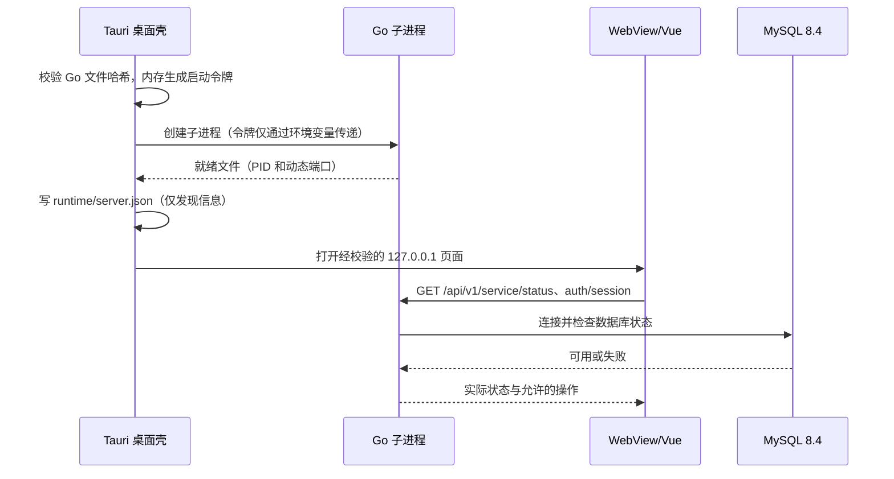
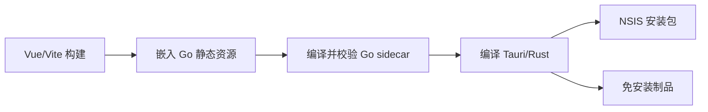

# 实现架构 · Tauri 2 / Go 1.27 / Vue 3.5 / MySQL 8.4

本文描述当前 `preview` 分支的**实际实现**。数据库结构和岗位授权详见 [原生 MySQL 架构](NATIVE_MYSQL_ARCHITECTURE.md)，历史迁移路径见 [单库存储迁移](MYSQL_ONLY_MIGRATION.md)，API 细节见 [接口契约](API_CONTRACTS.md)。

## 组件及信任边界

| 组件 | 当前实现 | 职责与边界 |
| --- | --- | --- |
| 桌面端（`desktop/`） | Tauri 2、Rust 1.100.0、WebView2 | 单实例、受限原生 IPC、校验并启动 Go 子进程、窗口和退出管理；不在网页中暴露桌面控制令牌 |
| 前端（`frontend/`） | Vue 3.5.45、Vue Router 4.6.4、Element Plus 2.14.8、ECharts 6.1.0、Leaflet 1.9.4、Vite 8.3.8、TypeScript 6.0.3 | 管理员及家属工作台、表单、图表、位置展示和连接状态；不直接访问数据库 |
| Go 服务（`backend/`） | Go 1.27.4、`net/http`、`goccy/go-json`、`go-sql-driver/mysql` | `/api/v1/` 业务接口、权限与事务、会话和 CSRF、设备身份与可选签名校验、静态前端资源；不负责安装 MySQL |
| 持久化 | MySQL 8.4、`database/sql` | 业务数据、会话、审计、健康及位置记录、图片 BLOB；不进行 PostgreSQL 生产双写或外部对象存储兜底 |
| 手表及模拟器（`YiheWatch/`、`watch-sim/`） | HarmonyOS ArkTS、Rust 1.100.0 | 按服务端设备契约上报采样与 SOS；不能直接写数据库 |

`preview` 使用 MySQL 单库；旧文档中的 PostgreSQL 分析投影、S3/SeaweedFS 和本地图片回退仅属于历史方案，不应据此部署当前版本。

## 实验性 Yihe-Core 加速

通过 `yihecore` 构建标签可静态链接 Rust 健康统计与个人基线计算内核。MySQL 仍是唯一权威持久化数据源；每次统计读取先执行原有服务端授权并校验已提交的版本号。可重建的内存列投影按既有缓存预算分片淘汰，无法使用时走原有 Go/MySQL 路径。默认构建与桌面发布暂不启用。构建、支持范围及验收限制见 [Yihe-Core](../yihe-core/README.md)。

MySQL 连接预算可按业务、健康统计、SOS 和探活划分。健康统计与最新采样接口可使用独立统计池；最新采样在同一个授权事务中读取或回填投影。SOS 可使用专用连接池提交事件与通知 outbox。各池仍连接同一主库；共享行锁、同步提交以及服务端授权不变。部署时按各进程连接预算核算 MySQL `max_connections`。

健康批量上报按设备串行准入；启用 SOS 优先选项时，优先请求在获取 SQL 连接前等待已取得事务执行权的同设备上传完成。仅在 BEGIN 阶段连接失效且尚无 DML 时有界重试；已执行的事务不会被抢占或重放。SOS 位置数据预处理移出锁定区间，持久化仍依赖事务内绑定校验和提交。

健康样本预处理使用批次内连续数值缓冲区；步数有序区间和睡眠阶段统计减少中间对象。最新采样回填对同一索引微秒内的所有候选比较载荷中的精确时间和 revision。只读 JSON 查询白名单支持客户端协商的 gzip 压缩，不压缩带 Cookie 的响应或错误响应。

## 启动与关闭

当前 Tauri 桌面程序**仍然启动独立的 Go 子进程**，并非完全无子进程的单体桌面程序。其主要步骤可由 [`desktop/src/main.rs`](../desktop/src/main.rs) 核查：

1. 从桌面资源目录读取 `yihe-server.exe`，对比构建时嵌入的 `desktop/backend-sha256.txt` 期望哈希；不匹配则拒绝启动。
2. 通过安全随机数生成本次启动的桌面控制令牌，作为 `YIHE_DESKTOP_TOKEN` 环境变量仅传入 Go 子进程；**不会**将该令牌写进 `runtime/server.json` 或传给页面 JavaScript。
3. Go 服务在本机回环地址选择端口，写入一次性就绪文件。Tauri 校验子进程 PID 和端口后，将 `runtime/server.json` 写为包含 `port`、`pid`、`desktopPid` 的发现记录，并以 `http://127.0.0.1:<port>/index.html` 打开界面。
4. 桌面初始化命令、窗口来源与关停操作受原生边界限制。Go 服务也可作为独立程序部署，此时监听地址和网络访问控制需由部署者显式配置。

桌面应用的用户资料存放于用户数据目录，不应放进安装目录。`runtime/server.json` 只用于进程发现，既不是数据库连接配置，也不是身份凭据.

## 初始化与访问隔离

首次管理员初始化由 Vue 引导页调用受限的 `setup_admin` 原生命令，经 Tauri 核对主窗口来源后才由 Go 处理 `/api/v1/setup`。普通浏览器请求仅有 Cookie 无法代替桌面启动令牌执行初始化。实现和权限边界见 [Tauri 初始化能力](../desktop/permissions/setup.toml)、[桌面能力配置](../desktop/capabilities/desktop.json)及[前端原生桥接](../frontend/src/desktop.ts)。

`GET /healthz` 仅表示 HTTP 进程存活；`GET /api/v1/service/status` 中的 `databaseReady` 表示当前业务数据库是否就绪。数据库不就绪时，静态界面和诊断仍可使用，而依赖数据库的业务操作可能返回 `503 DATABASE_UNAVAILABLE`。从故障恢复到重新取得有效会话之前，不应向用户宣称已登录状态或服务端注销已确认成功。

桌面启动的 Go 服务绑定回环地址，不能直接作为异地手表接入服务。需要持续接收外部设备上报与 SOS 时，应按 [常驻照护服务部署](CARE_SERVICE_DEPLOYMENT.md) 单独部署具备合适 TLS、监听及权限边界的服务实例。

## Web 接口、会话与数据库

- 正式业务入口位于 `/api/v1/`。业务响应使用 `returnCode: "1111"` 表示成功、`"0000"` 表示失败；错误对象还携带具体 `code`、`message` 等字段，详见 [接口契约](API_CONTRACTS.md)。
- 前端通过会话接口获得登录状态和 CSRF 令牌；服务端负责用户、岗位及资源级授权，不能以隐藏菜单代替权限检查。
- 当前持久化由 MySQL 承担。Go 进程读取 `MYSQL_DSN`；Tauri 桌面启动器可将 `YIHE_MYSQL_DSN` 映射为此变量。`PG_ANALYTICS_URL` 已退役，残留配置将被拒绝。
- 配置有效的 MySQL DSN 时，必须同时配置数据加密密钥。缺失或无效的密钥属于配置错误，不能将其描述为等待数据库恢复即可自动解决。
- 连接故障时前端展示数据服务状态，探测恢复不意味着失败的写操作可以自动重放。无法确认写入结果时应先核对状态，避免重复操作。

## 会话、授权与数据所有权

网页登录后，`YIHE_SESSION` Cookie 指向服务端会话。默认 `SESSION_BACKEND=database` 时，加密会话状态和撤销信息由 MySQL 持久化；指定 `memory` 仅适合单实例开发。断库期间的服务端注销可能无法确认撤销，不应把本地页面跳转等同于会话在服务端已删除。

认证入口在 IP 限流之后、CSRF/会话查询之前执行进程级非阻塞准入：登录预算为 `min(8, max(1, GOMAXPROCS/2))`，公开会话读取预算为 8；初始化校验桌面令牌后共享登录计算预算。已通过格式校验的同一账号在单进程内最多一个登录尝试，防止并发跨越持久失败计数。匿名会话创建另有 4 个并发槽、每秒 10 次、突发 64 次的令牌桶；先取得槽再扣令牌，已有有效会话不消耗创建配额。过载返回 429 与 `Retry-After: 1`，认证响应不缓存。这些是本进程资源预算而非跨副本全局限流或 SOS 延迟保证；现有持久风险控制、CSRF、会话撤销及权限语义不变。会话查找在同一请求内复用成功、未命中和存储失败结果（按 Store 与 Cookie 隔离），不跨请求缓存。公开会话入口将存储故障和密文解码故障视为 503，不误创建新匿名会话；缺少有效会话时先检查创建预算，再查询初始化状态。管理员会话资料接口仅复用本次请求已通过的粗粒度岗位门禁快照；有效管理员记录同时证明系统已初始化，省去额外用户表查询。独立调用资料接口仍实时查询岗位，停用账号及未通过门禁的请求不复用快照；业务读写事务内的权限锁和审计不变。数据库会话后端的成功登录在同一事务内使用新随机会话主键消费未过期旧会话，并写入成功审计；提交成功后才发放新 Cookie。重复消费、过期或已撤销的旧会话返回 CSRF 拒绝。审计失败时整个数据库轮换回滚，旧会话不被误撤销；不自动重试结果未知的提交。开发用内存后端不提供跨数据库审计原子性。

`internal/accesspolicy` 集中维护 API 访问策略，重要数据读写还需结合实时岗位权限和事务验证。服务端负责请求体大小与类型边界，前端不能以隐藏菜单、客户端缓存或未确认响应代替授权及状态事实。

业务主数据、图片 BLOB、会话与审计由 MySQL 持久化。用户数据目录下的 `server-console.log` 和 `runtime/server.json` 是日志与运行发现信息，不是业务数据备份。MySQL 迁移状态由数据库账本维护；旧 PG 数据须按专门迁移流程处理，不应把历史双库文档作为当前部署依据。

## 设备上报与可靠性

`POST /api/v1/device/report` 先校验设备号与设备密钥，再按绑定版本、采样时间和业务规则执行 MySQL 事务。设备签名相关接口使用 `X-Device-Signature`、`X-Device-Timestamp`、`X-Device-Nonce`；显式配置 `YIHE_REQUIRE_SIGNED_DEVICE=1` 才会强制拒绝缺少签名的请求，提供的签名则仍需验证。

不能将 `requestId` 去重说成**每一笔普通健康上报**都必定支持。SOS 的请求 ID 与绑定版本用于可靠重试；开启持久遥测队列时，满足条件的步数/睡眠数据使用合法请求 ID 入队。心率、血压、位置和紧急告警不走该普通遥测队列。具体条件见 [`telemetry_durable.go`](../backend/internal/handlers/telemetry_durable.go) 和 [设备签名设计](reliability/watch-device-signatures.md)。

`YIHE_DURABLE_TELEMETRY=1` 控制符合条件的加密步数/睡眠遥测入队，**不是**用于切换全部上报的 SQL 唯一键冲突语义。数据库写入失败或状态不确定时必须按接口真实结果处理，不能把“已接受请求”表述为“通知已送达”。

## 构建、发布与验证边界

`desktop/version.json` 是桌面产品版本入口；[版本校验脚本](../desktop/validate-version.ps1)核对前后端与桌面版本。Windows 构建依次处理前端资源、Go 二进制与哈希、Tauri 原生程序、安装与免安装制品，详细命令及签名边界见 [构建说明](BUILD.md)。

Go 单元与真实 MySQL 集成测试、前端 UI 检查、手表协议模拟、CodeQL 和发布门禁覆盖不同边界。缺失独立测试库、HarmonyOS SDK/硬件、真实通知网关或 Windows 真机安装证据时，相关项目必须标为未验证，不能以其他检查通过代替。见 [测试指南](TESTING.md)。

## 运行配置摘要

| 变量 | 实际作用 |
| --- | --- |
| `MYSQL_DSN` / `YIHE_MYSQL_DSN` | Go 服务的 MySQL DSN / Tauri 传给 Go 的 MySQL DSN |
| `DATA_ENCRYPTION_KEY` / `DATA_ENCRYPTION_KEY_FILE` | 32 字节随机数据密钥的 Base64 表达或受保护的密钥文件，必须安全备份和共享给相同数据域的实例 |
| `SESSION_BACKEND` | 默认 `database`；`memory` 仅适合隔离的单实例开发 |
| `BLOB_BACKEND` | 当前只支持 `mysql` |
| `YIHE_REQUIRE_SIGNED_DEVICE` | 为 `1` 时对适用设备接口强制要求签名 |
| `YIHE_DURABLE_TELEMETRY` | 为 `1` 时启用满足条件的加密步数/睡眠遥测队列 |
| `TEST_MYSQL_DSN` | 仅供测试进程使用，必须指向可销毁的独立实例 |

密钥、真实数据库 DSN、设备密钥和个人健康或位置记录不得写入仓库、Issue 或 PR 证据。构建和部署方式分别见 [BUILD](BUILD.md) 与 [TESTING](TESTING.md)。

### 持久化规则任务

迁移 0044 建立每设备一条 rule_task，设备更新、策略及阈值变更在原事务内唤醒任务。部署迁移前须停止旧版实例及其他数据库写入者。规则线程每五秒读取到期索引，先锁设备再锁任务，按绑定 epoch 核对后在同一事务中提交规则结果和下一次到期时间。回滚保留任务，重启无需重建进度。离线状态转换与精确超时、夜间边界（含夏令时）、未来采样和近期观察窗口保留定时检查。停用或解绑的任务可休眠，重新绑定或策略变更会唤醒。迁移 0045 使用生成列 offline_due_at 及到期索引维护独立照护在线会话重置任务，设备写入原子更新截止时间，后台只锁定到期设备。
